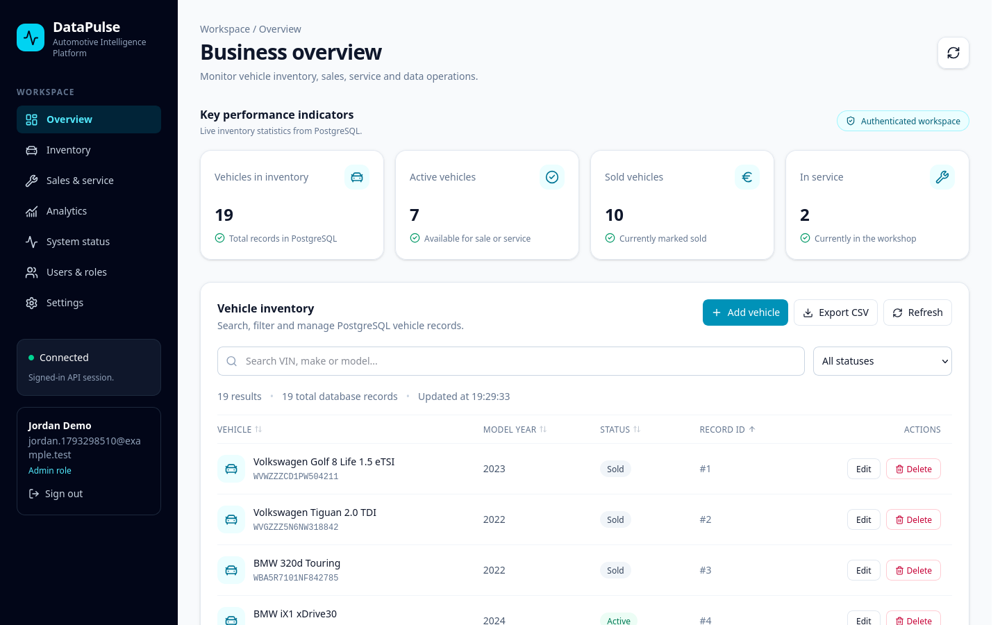
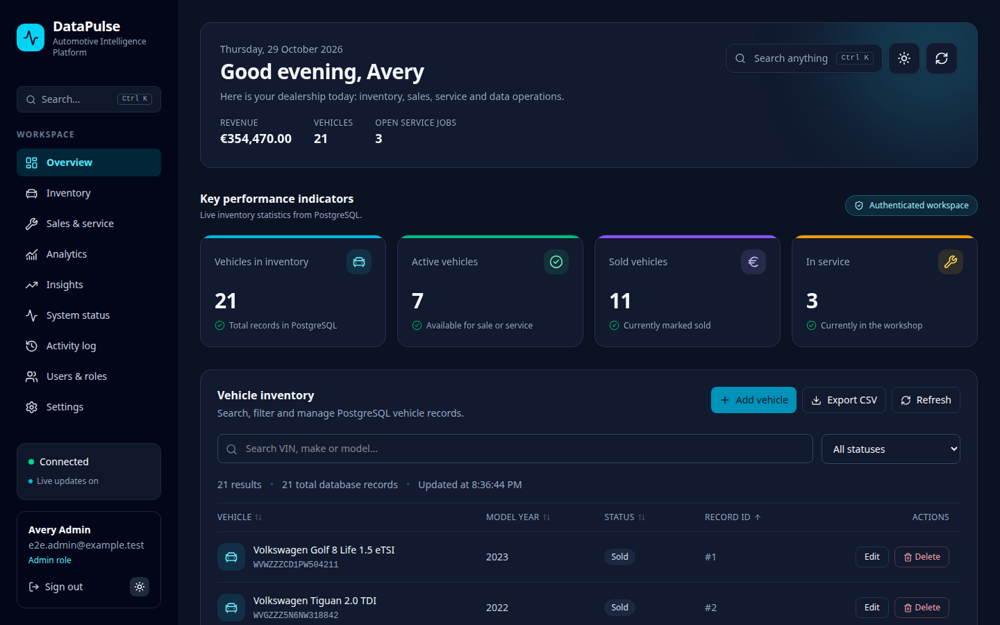
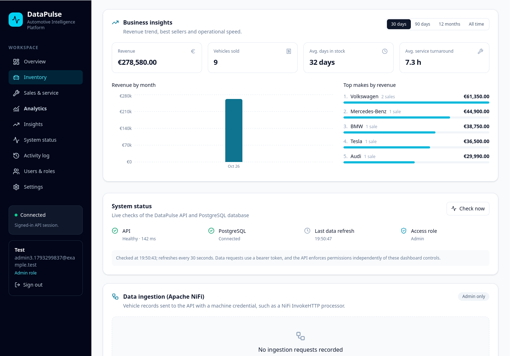
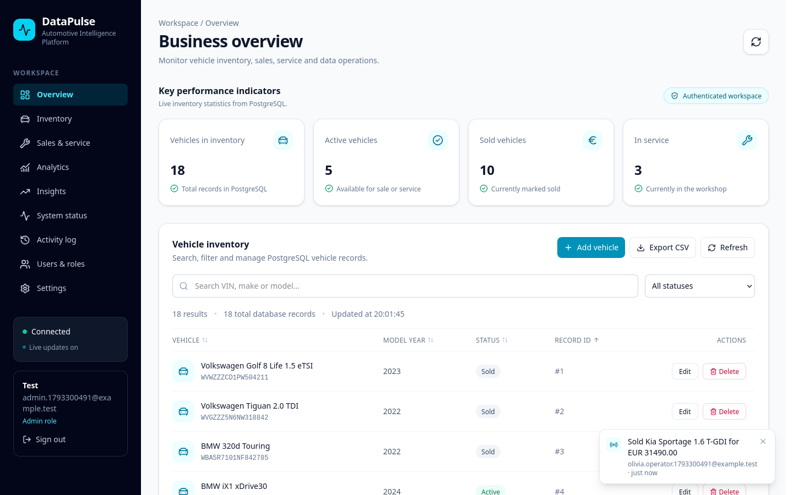
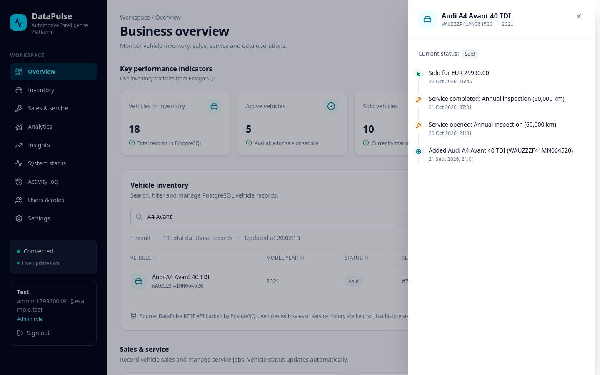
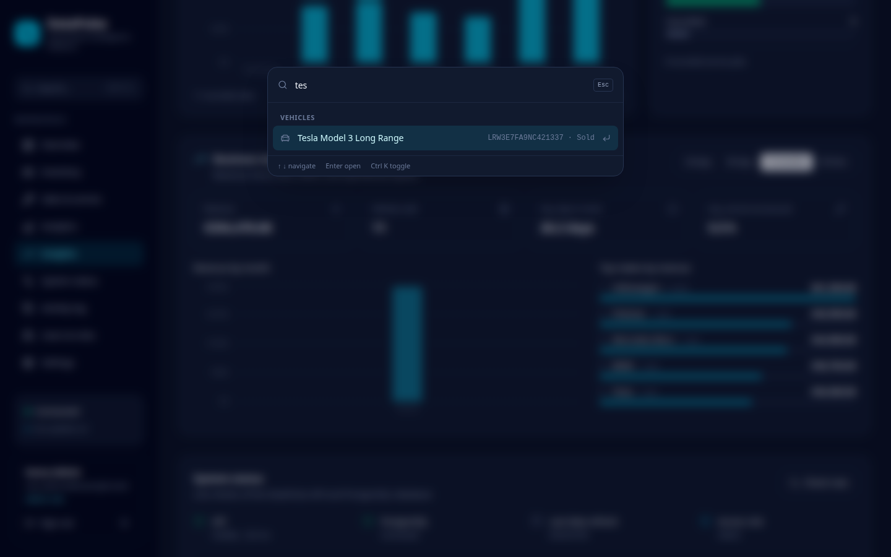

# DataPulse — Automotive Intelligence Platform

A full-stack platform for automotive dealerships: vehicle inventory, sales and workshop (service) management, live business KPIs and automated data ingestion through Apache NiFi, all behind role-based access.

[](https://github.com/Ali-Rauf368/datapulse-automotive-intelligence/actions/workflows/ci.yml)


**Live demo:** https://datapulse-automotive.onrender.com (free hosting; the first visit can take up to a minute while the server wakes up)

| Light | Dark |
| --- | --- |
|  |  |



| Live updates | Vehicle history | Command palette |
| --- | --- | --- |
|  |  |  |

## Features

**Experience**
- Split-screen sign-in page and a phone-friendly layout with a fold-away menu
- Personal overview with greeting, revenue, vehicle count and open service jobs
- `npm run seed:demo` also fills the Activity log and the Data ingestion panel with labelled sample entries (actor "demo-seed", flow "vehicle-ingestion (demo)"); `-- --remove` deletes them again
- Light and dark themes, remembered per browser
- Command palette (Ctrl/Cmd + K): jump to any section, open any vehicle's history or run an action from the keyboard

**Real-time collaboration**
- Every open dashboard updates the moment anyone records a sale, changes a service job or edits a vehicle (Server-Sent Events), with a notification saying who did it
- Notifications are sent only after the change has committed, so a rolled-back change is never announced

**Inventory**
- Search by VIN, make or model; filter by status; sortable columns; pagination
- Add and edit vehicles with VIN validation (17 characters, no I/O/Q)
- CSV import of up to 500 vehicles with a row-by-row report (invalid rows and existing VINs are listed, the rest are added in one transaction)
- CSV export of the current view (UTF-8, spreadsheet-safe)
- Vehicle history: click any vehicle for a timeline of when it was added, edited, serviced and sold, and by whom

**Sales and service**
- Record a sale: the vehicle becomes *Sold* in the same transaction, and a vehicle can never be sold twice
- Service jobs move *Open → In progress → Completed / Cancelled*; when the last open job closes, the vehicle returns to *Active*
- Vehicle status always matches its history, and the API rejects edits that would contradict it
- Sales and service history with CSV export

**Analytics and insights**
- Live KPIs: vehicles, active, sold, in service
- Seven-day revenue chart with total and average sale price; service jobs by status
- Business insights for 30 days, 90 days, 12 months or all time: revenue by month, top makes, average days in stock and average service turnaround
- Data-quality check that flags records whose status disagrees with their history

**Administration**
- User management: change roles and deactivate or reactivate accounts; admins cannot change their own account and the last active admin is always kept
- Activity log: every sale, service update, vehicle change and role change is recorded with who did it and when, in the same transaction as the change

**Security and operations**
- Email/password sign-up (always *Viewer*), bcrypt hashing, 8-hour JWT sessions re-validated on every request
- Roles: Viewer (read), Operator (sales, service, inventory), Admin (plus delete and ingestion logs)
- Rate limiting on sign-in and sign-up, security headers, JSON errors without stack traces
- Live API and database health with response time
- Request IDs on every response (also shown in error messages) and one structured JSON log line per request with status and duration
- Interactive OpenAPI 3.1 documentation (Swagger UI) at `/api/docs`
- Docker image and Compose file for a one-command local stack

**Apache NiFi integration**
- NiFi's InvokeHTTP processor posts vehicles to `POST /api/vehicles` with a machine credential
- Credentials are shown once and stored only as SHA-256 hashes; they can add vehicles and nothing else
- Every ingestion request is logged, and admins see outcomes in the dashboard

## Architecture

```text
 ┌──────────────┐  JSON over HTTPS  ┌────────────────────────┐  SQL  ┌──────────────┐
 │ React + Vite │ ────────────────▶ │ Express API (TypeScript)│ ────▶ │ PostgreSQL 16 │
 │  dashboard   │   Bearer token    │ auth · RBAC · rules     │       │              │
 └──────────────┘                   └────────────────────────┘       └──────────────┘
                                              ▲
                     ┌────────────┐  machine  │
                     │ Apache NiFi │ ─────────┘  POST /api/vehicles
                     └────────────┘  credential
```

| Layer | Technology |
| --- | --- |
| Frontend | React 19, TypeScript, Vite, Tailwind CSS, Recharts, lucide icons |
| Backend | Node.js 24, Express 5, TypeScript (strict), JWT, bcrypt |
| Database | PostgreSQL 16 with SQL migrations |
| Testing | Vitest + Supertest (115 API tests), Playwright browser tests, disposable PostgreSQL per run |
| API docs | OpenAPI 3.1, Swagger UI |
| Delivery | Docker, GitHub Actions CI, Render Blueprint deployment |

### Project structure

```text
src/                     React dashboard
  components/            Login, sidebar and one component per dashboard section
  hooks/                 Data loading, health polling, scroll tracking
  lib/                   API client, formatting, CSV export
server/src/
  app.ts                 Middleware and route wiring
  routes/                auth, health, vehicles, sales, service, analytics, users, docs
  lib/                   Transactions, audit log, live events, request logging,
                         vehicle status rules, rate limiting
  openapi.ts             OpenAPI 3.1 description
  auth/                  JWT sessions, roles, machine credentials
  migrations/            SQL schema (000–003)
  scripts/               Admin, roles, demo data, migrations, NiFi credential
  __tests__/             API, auth, workflow and security tests
render.yaml              One-click Render deployment
```

## Getting started

Requirements: Node.js 24, npm 11, PostgreSQL 16.

```bash
git clone https://github.com/Ali-Rauf368/datapulse-automotive-intelligence.git
cd datapulse-automotive-intelligence
npm ci
cp .env.example .env          # set DB_* and a JWT_SECRET of 32+ characters
npm run db:migrate            # create the schema
npm run setup:admin           # create the first administrator
npm run seed:demo             # optional: realistic demo data
```

Run the API and the dashboard in two terminals:

```bash
npm run server:dev                  # http://localhost:3000
npm run dev -- --host 127.0.0.1     # http://127.0.0.1:5173
```

### With Docker

```bash
JWT_SECRET=$(openssl rand -hex 32) docker compose up --build
docker compose exec app npm run setup:admin   # first administrator
```

The app is then at http://localhost:3000 and the API documentation at http://localhost:3000/api/docs.

## Scripts

| Command | Purpose |
| --- | --- |
| `npm run server:dev` / `npm run dev` | API and dashboard in development mode |
| `npm run build` | Type-check everything and build the dashboard |
| `npm run lint` / `npm run typecheck` | ESLint / TypeScript |
| `npm run test:isolated` | All tests on a temporary PostgreSQL (no setup, never touches your data) |
| `npm test` | Tests against an existing `*_test` database |
| `npm run test:e2e:isolated` | Browser tests in Chromium on a temporary PostgreSQL |
| `npm run db:migrate` | Apply migrations (safe to re-run) |
| `npm run setup:admin` | Create the first administrator |
| `npm run setup:role -- <email> <role>` | Change an account's role |
| `npm run seed:demo` / `-- --remove` | Add or remove demo data |
| `npm run setup:nifi-credential` | Create a NiFi machine credential |

## API

Errors are always JSON (`{"error": "..."}`). "Any credential" means a signed-in user or a machine credential.

| Method and path | Access | Purpose |
| --- | --- | --- |
| `GET /api/health`, `/api/health/db` | Public | Liveness and database readiness |
| `POST /api/auth/register`, `/login` | Public (rate limited) | Create a viewer account / sign in |
| `GET /api/auth/me` | Signed-in user | Current profile |
| `GET /api/vehicles`, `/stats`, `/:id` | Any credential | List (`search`, `status`), KPIs, one vehicle |
| `POST /api/vehicles` | Admin, operator, NiFi | Add a vehicle |
| `POST /api/vehicles/import` | Admin, operator | Import up to 500 vehicles with a per-row report |
| `PATCH /api/vehicles/:id` | Admin, operator | Edit a vehicle |
| `DELETE /api/vehicles/:id` | Admin | Delete a vehicle without history |
| `GET /api/sales`, `/api/service` | Any credential | Sales and service history |
| `POST /api/sales` | Admin, operator | Record a sale |
| `POST /api/service`, `PATCH /api/service/:id` | Admin, operator | Open or update a service job |
| `GET /api/analytics/sales`, `/service` | Any credential | Analytics |
| `GET /api/analytics/insights?range=` | Any credential | Monthly revenue, top makes, stock and service times, change vs previous period, highlights |
| `GET /api/users`, `PATCH /api/users/:id` | Admin | List users, change role or access |
| `GET /api/audit?entity=&limit=` | Admin | Activity log |
| `GET /api/operations/nifi-logs` | Admin | Recent ingestion outcomes |
| `GET /api/vehicles/:id/history` | Any credential | Vehicle timeline |
| `GET /api/events` | Signed-in user | Live change stream (Server-Sent Events) |
| `GET /api/docs` | Public | Interactive API documentation |

## Engineering notes

The full reasoning, with alternatives and trade-offs, is in [ARCHITECTURE.md](ARCHITECTURE.md).


- **Consistency under concurrency:** sales and service writes lock the vehicle row inside a transaction, so two simultaneous requests cannot sell the same car twice.
- **Status follows history:** a vehicle's status is derived from its sales and service records, and both the UI and the API enforce it.
- **Tested like a user:** Playwright drives the real dashboard in Chromium, including two users in separate browsers where one sells a car and the other's dashboard updates by itself. These run in CI on every push.
- **Safe tests:** the suite refuses any database whose name does not end in `_test`, signs tokens with its own random secret and cleans up everything it creates. `test:isolated` runs it on a throwaway PostgreSQL cluster.
- **Real-time without polling:** changes are queued during the request and broadcast over Server-Sent Events only after a successful response, i.e. after commit. A single instance fans out in memory; scaling out would move the channel to PostgreSQL LISTEN/NOTIFY.
- **Traceable:** a request ID ties a user's error message to exactly one structured log line.
- **Auditable by design:** audit entries are written inside the same transaction as the change they describe, so the log never claims a change that was rolled back.
- **Resilient UI:** each dashboard panel loads independently, so one failing request shows a retry in that panel instead of breaking the page.

## Deployment

`render.yaml` is a Render Blueprint: **New → Blueprint** creates a PostgreSQL database and one web service that runs migrations on start and serves both the API and the dashboard. See [docs/deployment.md](docs/deployment.md).

## Documentation

- [Architecture and design decisions](ARCHITECTURE.md)
- [User guide](docs/user-guide.md)
- [Deployment](docs/deployment.md)
- [NiFi backup and restore](docs/nifi-backup-restore.md)

## Author

Ali Rauf · [GitHub](https://github.com/Ali-Rauf368)
